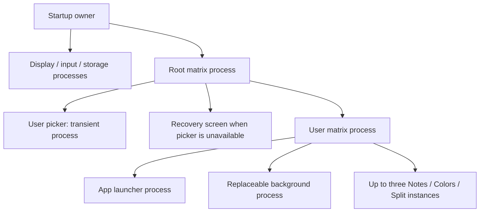

# Follow the running distribution

Press **F5** at the repository root, or run:

```powershell
python tools/boot-harness-rs/run.py --release --window
```

F5 opens a full-screen user picker with a horizontal row of avatar tiles.
**NEW USER** copies the hidden template; click a user to enter its workspace.
The user gets an app strip with **Notes**, **Colors**, **Split** and **Nested** tiles and the rest of
the display for its app. Click the app to focus it. Notes and Colors have an **X**;
Notes asks **Save / Discard / Cancel** for unsaved work. There is no storage test
toggle, launcher entry or permanent status text in the ordinary UI.

[Split](applications/split/README.md) runs two persistent Notes in its own matrix.
**DEEPER** asks them about unsaved work, then runs the same matrix beneath a
separate saved realm. Both levels own their layout and attenuate their children's
services. An unfunded further level reports **NO ROOM** without losing drafts.

**Nested** starts a scoped copy of the same login/desktop flow inside the app
area. Create and select an inner user, then run Notes or Colors there. Its files
stay inside that Nested program's realm. Close it using the outer task-row X;
any unsaved descendant refuses that close. Owner-mediated funding supports two
inner leaf apps at a time; a third or another Nested level reports **NO ROOM**. Close other
outer apps before launching Nested. This is a bounded composition proof, without
authentication, encryption or hardware virtualization.

Notes holds up to eight notes of 240 characters: **F1** saves or reconciles,
**F2** reloads, **F3** duplicates the saved note, **F4** switches notes. Colors
changes on **Enter**. Arrows and Enter also navigate a focused picker/launcher.
There is no logout yet; restart QEMU to select another user. The picker handles
up to three users without scrolling and hides New User at its limit.

Click **SETTINGS** at the bottom of the user's app strip to adjust its width and
outer spacing. **SAVE** persists and applies the layout to running apps; **CANCEL**
discards local edits and returns to apps. Apps keep their document state while
rebuilding their local views. A saved layout survives reboot. If applying is
refused, SAVED; RESTART distinguishes the durable save from live placement.
A refused program shows **CANNOT OPEN**; an admitted program that fails shows
**APP STOPPED**. The launcher stays available for another choice. A user matrix
that fails while loading its arrangement returns to the user picker. Normal app
close does not display a crash message.

For an app that cannot close itself, **END APP** appears above Settings while an
app is running. It warns **UNSAVED WORK MAY BE LOST** and defaults to **CANCEL**.
Confirming ends that exact app and its descendants; saved work remains. With
launcher focus, **F3** opens this warning, arrows choose, and Enter activates.
The restarted launcher can manage an already-running app. This is ordinary
delegated launcher authority; it cannot recover a failed matrix or input service.

If `Login` or `Users` cannot be resolved, the login executable is rejected, or
the picker dies, the startup owner shows **SIGN-IN UNAVAILABLE / TRY AGAIN**.
The [recovery screen](desktop/recovery/main.rs) comes from boot media, so it
does not need another readable stored program. Click the button, or press Enter
with focus, to retry. Display/input come up before storage; while the volume opens,
the same screen shows **STARTING...**. A failed, malformed or timed-out storage
startup becomes retryable after its task and endpoints are collected. It does not
repair or overwrite data. Earlier display/input/root admission gets one bounded
retry after full cleanup. If root or input still cannot start, display alone shows
**COULD NOT START / PLEASE RESTART**. If display itself cannot start, the launch
terminal reports the failed stage and error. These failures never open storage.

If the configured app strip crashes, its matrix attempts one local restart,
preserving the running app and its draft. The replacement keeps the current
layout. A second crash, or failure to read/admit its replacement, shows
**LAUNCHER UNAVAILABLE / TRY AGAIN** within the strip. Click Try Again, or focus
that screen and press Enter, to request one more attempt. It preserves the app's
draft and current layout, and does not replenish automatic retries. A broken
recovery screen does not restart itself. Apps can still save and close themselves.

Initial stock defaults live in [matrix.conf](matrix.conf);
installation preserves existing saved arrangements.

The default input service negotiates QEMU's absolute virtual mouse so the guest
cursor follows the host pointer within the window. It falls back to relative
PS/2 input when that interface is unavailable. The explicit
[stock-program upgrades](migrations/README.md) refresh existing recognized user
launchers/apps while preserving saved data and customized programs.

Everything persists in `build/boot-harness-rs/cathedral-storage.raw` across
launches and QEMU restarts: the users you made, their notes and colors. The
first boot creates this experimental database image and installs the programs
into it; later boots preserve it and reinstall only programs whose bytes
changed. Earlier lab images remain separate and untouched. Every program's
state nests under its own object, and a user is a subtree copy of the template,
so a new user costs a few records until its notes diverge.

## Executable route

Start at [desktop/main.rs](desktop/main.rs), then the
[session entrance](desktop/session/session.rs) and
[shell policy](desktop/session/shell/shell.rs). Admission starts providers and a
funded root matrix. The desktop runs the chooser in the root's first slot,
shown only the folder of users, and opens the second slot with a standing
launch policy: whatever the chooser launches lands there with that budget and
placement. It resolves `Login` and `Users` by path. When a user matrix appears,
the desktop retires the picker and requests `CONFIGURE`. The
[user matrix](../distribution/matrix/service/children/configuration.rs)
loads its own `Matrix` object and resolves the saved launcher path, then sets
its child budgets and placement. The outer owner supervises storage and restores
the user's binding after provider replacement; that matrix restores its own
child bindings. Each level of this stock tree runs the same distribution matrix
program over shared platform mechanisms. The independent
[three-peer matrix proof](lab/matrix-composition/README.md) uses a different program.

The process tree is distinct from the executable/package tree:



The root matrix admits the selected user as the picker's sibling. The startup
owner then stops/collects the picker before asking the user to load its launcher;
that wait can take time and must not leave the picker visible or interactive.
The app launcher is a different process using the chooser executable, not a
mode switch of the old picker. Colors has its own application executable and
runs in a separately confined app process.

The [login design](../../wiki/design/part_1_authority/07_sessions_and_login.md)
already specifies a transient credential broker: it receives verification
authority, root arranges authorized access to the unlocked realm and transfers
the seat, and the broker exits. Neither broker nor matrix receives the realm
key; the broker does not host the session. See the accepted
[matrix authority boundary](../../wiki/spec/execution/components_and_matrices.md). The Rust picker only exercises selection, sibling
admission and lifecycle; it has no Warden, authentication or sealed realms and
currently holds broader unencrypted storage access than that future broker.

[profile.json](profile.json) is the executable composition shared by F5,
ordinary CLI boot and [the desktop test](../../tools/boot-harness-rs/desktop_test.py).
The harness builds the boot launches and supplies their ELF artifacts to
[kernel startup](../kernel/boot/uefi/startup.rs); it trims the `programs` to
their loadable bytes, appends the optional `display_title` footer, and installs
them into the storage image as objects of
the notes root, in order and nested as the profile says, with `folder` entries
as empty containers. The kernel sees supplied code and grants; the distribution
assigns budgets and placement, and the choosers launch programs from their
realms by object number. The UI hides the template/launcher and shows user avatars at boot and
NOTES / COLORS tiles inside the user. See the
[chooser](applications/chooser/README.md) for the bounded display-title format.

| Role | Composition entry | Entrance / receiving implementation |
| --- | --- | --- |
| Desktop owner | Initial | [main](desktop/main.rs), [admission](desktop/session/admission/admission.rs), [shell](desktop/session/shell/shell.rs) |
| Display | Launch 0 | [display main](../platform/services/display/main.rs), [retained compositor](../platform/services/display/compositor/compositor.rs) |
| Input | Launch 1 | [input main](../platform/services/input/main.rs), [matrix source](../platform/services/input/matrix.rs) |
| Root matrix | Launch 2 | [matrix main](../distribution/matrix/main.rs), [service loop](../distribution/matrix/service/service.rs) |
| Object storage | Launch 3 | [storage main](../platform/services/storage/main.rs), [object contract](../platform/contracts/storage.rs) |
| Sign-in recovery | Catalogue executable 0 | [recovery main](desktop/recovery/main.rs), controlled by [login phases](desktop/session/shell/login.rs) |
| Chooser | Program 1 | [chooser](applications/chooser/session/session.rs), shown the folder of users |
| Users | Program 2, a folder | Holds the template and every user copied from it |
| Template user | Program 3, inside Users | Same matrix service; a user matrix hosts its chrome and one app |
| Chrome | Program 4, inside the template | The chooser again, over the user's realm |
| Notes | Program 5, inside the template | [notes main](applications/notes/main.rs), [editing/storage/view](applications/notes/session/session.rs) |
| Colors | Program 6, inside the template | [Colors main](applications/colors/main.rs), [session](applications/colors/session/session.rs) |

A chooser queries executable entries in its realm and asks its host to run an entry with `LAUNCH`. The
host reads the object through the chooser's own binding, so only what the
chooser can see can run, starts it as the chooser's sibling in the slot its
owner opened, grants it the entry's subtree, and names the slot in the reply.
`CLOSE` asks the host to stop that sibling; the host first asks the sibling
with `LOSS` what it would lose and stops it only on an answer of nothing. A
chooser holds no other launch authority and writes to its realm only to copy
the named template on NEW in user-picker mode. Apps see local geometry and input, not global
placement, other apps or an ancestor's services. The
[matrix contract](../platform/contracts/matrix.rs) and
[child launches](../distribution/matrix/service/children/children.rs)
connect this distribution policy to the platform mechanism.

## Engineering proofs

```powershell
python tools/boot-harness-rs/desktop_test.py
```

This builds the default composition, copies a user from the template, launches
its programs with physical mouse and keyboard input, checks exact note glyphs
and status, protects unsaved drafts, duplicates and switches notes, checks
optional storage and required-service refusal, repeatedly
replaces apps, checks the boot picker disappears and cannot receive input,
cold-boots the same disposable disk to check saved state, and
has an independent host model verify the retained records. It never touches
the interactive disk.

Recursive whole-user LOSS and teardown/recreation remain covered by the
headless `--matrix-test` fixture; they are not a logout workflow in this desktop.

Other profiles remain focused mechanism and fault tests, not competing default
OS entry points. [The desktop guide](desktop/README.md) describes its recursive
matrix, storage and provider-recovery proofs. `--smoke` selects the profile's
`user_programs` for exhaustive kernel exercises.

The [implementation map](../STATUS.md) tracks remaining restrictions. In
particular this is one chooser over a folder and one app per user at a time,
not a package installer, general desktop window manager or production filesystem.

[Split](applications/split/README.md) is also installed in the ordinary app strip.
It demonstrates a different matrix program: two temporary Notes instances, its
own arrangement and close policy, and no storage offered to its children. The
stock desktop still owns user selection, its launcher and saved outer layout.

The app tiles launch new instances. Rows below them switch running instances; each
row's X requests a loss-checked close. Private drafts survive switching. The app's
own X offers save/discard choices. The background and configured chrome are separate
replaceable programs; see [stock matrix roles](matrix/CHARTER.md#desktop-roles-and-instances).
Split demonstrates a custom two-pane matrix; Nested runs the stock picker and
desktop recursively. The platform owns neither this app limit nor these desktop roles.

## Nested startup and scene switching

The Nested tile loads the [stock matrix](matrix/main.rs) compiled with
`nested-desktop`. Its [startup coordinator](matrix/service/children/startup/startup.rs)
prepares missing seed names inside its supplied realm, runs the ordinary chooser
over `Users`, retires that picker on selection, and lets the selected user matrix
run the same saved CONFIGURE path used by the outer desktop. The nested template
contains another Nested executable and finite seed programs; it does not recursively
materialize more users until launched. Existing names/data are preserved.

[Admission](matrix/service/children/admission.rs) checks declared resource needs
against owner ceilings before spawn. Surface ranges are allocated without moving
live siblings. The existing storage forwarding chain supplies every scope stamp;
there is no direct provider or ancestor-realm connection in the nested program.
The nested seed copier is distribution policy, not a platform filesystem operation.

[Workspace selection](matrix/service/children/workspace.rs) stages changed app
visibility through [scene publication](matrix/service/parent/scene.rs). The upstream
matrix chain validates and commits the retained scene together, so switching cannot
publish a half-hidden old app beside half of the new one. Rejection aborts the batch
and preserves selection. This is scene atomicity, not display-vblank synchronization.
