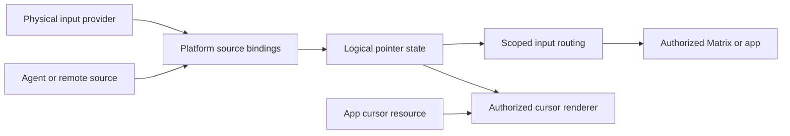

# Input sources and scoped pointer leases

The accepted [input foundation](../spec/human_surface/input.md),
[channel contract](../spec/human_surface/input_channels.md) and
[focus contract](../spec/human_surface/focus_routes.md) own delivery, registration,
exclusive group control, channel association and recursive local selection.
They supersede conflicting seat or focus assumptions below. The accepted
[input provenance rule](../spec/human_surface/input.md#upstream-provenance-is-not-input-metadata)
also supersedes the earlier mandatory-attribution proposal: upstream source details
are private unless explicitly disclosed. Remaining material explores protocol
details, not an app-visible physical/synthetic distinction.
The [presentation contract](../spec/human_surface/rendering.md) now also owns
accepted-layout hit-testing and pointer-target cursor preference/suppression.

The platform should route input through logical pointers that can be driven by
authorized sources. A hardware mouse is one source. A Matrix can delegate a
pointer within its own subtree without handing an app the operator's mouse or
keyboard focus.

| Status | Scope |
| --- | --- |
| Proposed | Candidate architecture, not an accepted Cathedral contract |
| Specification owners | Partial [input](../spec/human_surface/input.md) and [compositor/seat](../spec/human_surface/compositor_and_seat.md) contracts; this proposal's remaining choices are not accepted |
| Implementation evidence | [Rust pointer lab](../../source-rs/distribution/lab/compositor/POINTERS.md) exercises one physical and one scoped synthetic pointer; production seats, multiplexing and recursive leases are absent |

## Separate the objects

The [windowing design](../design/part_6_human_surface/00_windowing_and_compositor.md)
already anticipates multiple labeled cursors, agents and remote collaboration.
The accepted contracts separate motion, visual presence, keyboard selection
and permission to act; a cursor does not require a mandatory full seat.

| Object | Responsibility |
| --- | --- |
| Input source | Produces normalized events from a device, agent, remote participant or replay |
| Source binding | Grants source control over a logical pointer; keeps enforcement evidence private to authorized owners |
| Logical pointer | Tracks identity, position, button state and capture within an authorized coordinate space |
| Cursor visual | Presents the pointer's sprite, hotspot and visibility; no automatic upstream attribution |
| Pointer lease | Delegates specified control or observation rights within a Matrix subtree and lifetime |
| Focus group | Accepted local association of channels and selection; see the [focus contract](../spec/human_surface/focus_routes.md) |

A pointer's identifier is not a capability. Knowing it does not grant motion,
button injection, observation or capture. A visual-only collaboration marker
needs no authority to activate controls. Permission to move an actionable
pointer need not include keyboard focus or the right to drive another pointer.

The platform owns binding, routing and disclosure enforcement. A distribution supplies
the default device profile and presentation choices within those rules. The
kernel supplies isolation, device access and IPC mechanisms; it need not know
cursor names, pointer acceleration or which child is under a cursor.

## Default pointer and multiplexing

Startup policy can create an operator pointer and permit local mouse devices to
drive it. Another profile can give each device its own pointer. A remote session
or app can receive a separate lease without replacing that default binding.

ZII describes a useful empty state, not an ambient grant. A zero or absent pointer
lease is inert. Creating the default pointer and attaching hardware requires
established authority, consistent with the
[substrate's zero-state rule](../design/part_0_foundations/01_omega_substrate.md).

Multiplexing belongs above normalized device input. Keep source identity and
held-button state until the binding policy combines them. If two sources share
a pointer, one source releasing a button must not erase the other source's held
state. Device removal must retire that source's contribution. The contract must
choose an aggregation or exclusive-control policy and define event ordering.

Hardware origin may be retained privately by the owner enforcing a protected
physical recovery path. A child cannot manufacture that authority by naming a
pointer "operator". This does not create an app-visible physical-origin flag or
query: authorized logical input is consumed without learning whether its upstream
source is human, software, remote or supplied by an analysis environment.

## Delegation inside a Matrix

A host can delegate pointer rights only within authority it holds. A child lease
names its subtree, coordinate space, permitted operations and lifetime. Moving
outside its bounds, reaching siblings or targeting the root's protected prompts
requires authority that the child lease does not supply.

Each hosting level applies its transforms and routing restrictions. Flattening
the scene for drawing does not bypass input interception, clipping or occlusion.
The [accepted-layout rule](../spec/human_surface/rendering.md#hit-testing-and-displayed-state)
permits displayed pixels to lag hit-testing. Each local decision uses coherent
geometry and keeps its target fixed; exact presented-frame matching and strict
screenshot-context rejection are not required.

Capture belongs to a particular pointer, target and grant. A pointer lease alone
does not hide the operator's cursor, capture another pointer or transfer keyboard
focus. Focus-on-click can be an authorized policy; it is not an automatic power
of every cursor visible within a Matrix.

For example, a collaborative editor could host three participant pointers and
one agent pointer. A participant might receive a visual marker only, while the
agent receives bounded motion and activation within the document. The local
operator keeps an independent pointer and the reserved escape path.

## Cursor attribution and indicators

The [presentation contract](../spec/human_surface/rendering.md#cursor-presentations)
now owns bounded cursor surfaces, per-pointer target preferences, no-cursor
requests and recursive owner-controlled handoff. Hiding does not imply pointer
lock or capture, and keyboard selection does not determine cursor preference.

An enclosing owner may display session information it is authorized to know in its
own UI. That is separate from child cursor presentation and confers no observation
right on the child. No mandatory agent label, remote badge or hidden-target
attribution fallback is required. Apps can request custom assets or hiding without
knowing how the pointer is driven; app-supplied text is not authenticated identity.

Cursor assets follow the accepted [resource lifetime](../spec/human_surface/rendering_resources.md).
Decorative pixels confer no input authority or right to cover protected output.

## Lifetime and bounded work

Pointer state and queued events must distinguish lease incarnations. Reusing an
identifier after app death must not deliver old motion or clicks to its successor.
Revocation, source loss, target loss and host death need defined capture release
and cancellation behavior. Clearing a drag must not synthesize a successful click
on a different target.

The current focus chapter says already-queued events drain. Pointer revocation
needs that reconciled with cancellation and the
[pending-IPC question](../../OWNER_QUESTIONS.md#endpoint-transport-and-revocation-of-pending-ipc).
This proposal does not decide that revocation undoes committed input. The final
contract must identify the commitment point and how held state is cleared on
both sides without authorizing new actions.

Bound pointer count, event queues, update work and cursor-resource residency
separately. A large shared bitmap is not permission to create unlimited cursors.
Motion can be coalesced only where the chosen event mode permits it; button and
capture transitions need ordered delivery or an explicit reset protocol. Reserve
enough platform capacity for operator recovery under a flooding source. Exact
ceilings and fair scheduling are implementation choices within that guarantee.

## Accepted topology and remaining presentation choices

The [focus contract](../spec/human_surface/focus_routes.md) replaces the earlier
mandatory-seat alternatives with explicit channel association and privately
controlled groups. The [channel contract](../spec/human_surface/input_channels.md)
already defines channel-tagged delivery and application-owned role assignment.
Cursor handoff is settled by the [presentation contract](../spec/human_surface/rendering.md#cursor-presentations);
upstream disclosure is settled by the
[input provenance rule](../spec/human_surface/input.md#upstream-provenance-is-not-input-metadata).
Compatibility adapters must preserve the accepted authority and channel boundaries.

## Acceptance evidence

Before promoting this proposal to a contract, establish:

- Two physical sources sharing a pointer, and two independent pointers, with
  ordered button handling across disconnect and source rebinding.
- A visual-only lease that cannot activate controls, and an actionable child
  lease that cannot reach siblings, ancestors or protected prompts.
- Nested transforms, clipping, occlusion and scene changes with matching visible
  cursor position and routed targets.
- Capture cancellation, source/target/host death and stale queued events without
  stuck state, inherited authority or a click on a replacement target.
- App-provided shared cursor assets, bounded resources and owner restoration on
  target loss, without mandatory origin labels or per-ancestor redraws.
- Equivalent supplied input from physical, remote and software sources exposes
  no automatic origin flag to the child; it still cannot forge the upstream
  physical recovery gesture or gain unrelated observation rights.
- Explicit seat/focus and compatibility-adapter rules, with budgets that keep
  an abusive source from monopolizing routing and cursor updates.

The [Rust pointer lab](../../source-rs/distribution/lab/compositor/POINTERS.md)
supplies bounded evidence for separate physical/synthetic identities, clipping,
capture, cancellation and app/source failure. Its two app scopes, fixed cursor
visuals and boot-approved source connection do not establish production seat
semantics, multiple physical devices, protected prompts or recursive delegation.
The [session lab](../../source-rs/distribution/lab/compositor/SESSION.md) adds
separate host/child processes, explicit input regions, event waits and attenuated
keyboard-focus grants. Its child receives only Enter; synthetic clicks cannot
acquire keyboard focus, and parent loss revokes descendant input. Focus-change
queue cancellation supplies partial evidence for the accepted
[focus transitions](../spec/human_surface/focus_routes.md#selection-changes-and-outstanding-input),
not a general multi-group implementation.
The list above remains the acceptance bar. Acceptance updates the compositor/seat specification,
affected source contracts and the conflicting seat and agent design prose.
