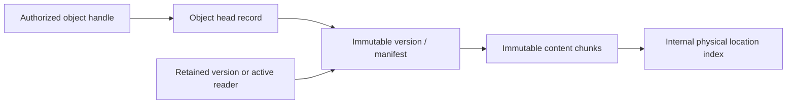

# DBFS storage foundation

| Status | Scope |
| --- | --- |
| Proposed | Engine-selection and layout experiment; no accepted disk format or production API |
| Specification owner | Unwritten `spec/storage/realms_and_objects.md`; see the [coverage map](../spec/README.md) |
| Existing evidence | [Private catalog](../../source-rs/platform/libraries/object-store/CHARTER.md): bounded disk transactions and recovery, without chunk allocation or snapshots |
| New evidence | [Host layout lab](../../tools/storage-lab/README.md): flat/tree chunk references, inline contents, range reads, batched edits and retained versions |

## Direction and boundaries

DBFS should build on established database techniques. A transactional ordered
key/value metadata engine plus immutable bulk-content storage is a candidate,
not a chosen implementation. BLAKE3 is the provisional content-hash candidate;
its internal 1 KiB hashing chunks do not choose storage chunk boundaries.
Neither this proposal nor the host lab freezes a hash encoding or on-disk ABI.

Storage policy, object semantics, queries, version retention and subscriptions
belong in the common userspace platform. The kernel supplies isolation, IPC,
memory and device authority. Distribution supplies defaults and user experience.
Atomic changes spanning durable storage and kernel authority remain the existing
[owner question](../../OWNER_QUESTIONS.md#kernel-mechanisms-versus-platform-orchestration).

The immediate requirement is a bounded foundation for small objects and large
byte streams, with efficient range edits and explicit committed versions. Its
public model must not expose global hash lookup as read authority. Sharing
physical content does not merge object identity or realm authority.

## Candidate representation

| Record | Meaning |
| --- | --- |
| Object ID to head version | Stable identity across edits; mutations authorized at this boundary |
| Version to metadata and content manifest | Immutable state, including logical length and representation |
| Content digest to physical location(s) | Internal, movable placement; no application authority |
| Parent ID and name to child reference | Namespace edges; sharing and alias semantics remain proposed |
| Commit sequence to changes | Durable observation records published with the affected state |

The logical object graph can live over ordinary indexed records. A graph-shaped
interface does not select a graph database. Logical object identity, version
identity, content digest and physical location must remain distinguishable.
Hash inputs need a canonical encoding, explicit lengths and separation between
node kinds. Empty content has its actual digest; an inert zero handle is a
separate API convention, never an assertion that BLAKE3(empty) is all zeroes.

The host experiment implements chunks, flat or fixed-fanout tree manifests, range
reads, batched range replacement and an explicit list of retained versions. It does not implement the object table, capabilities,
queries or publication transaction in this diagram.

## One update and its failure boundary

For a 100-byte replacement in a 10 MiB object:

1. Resolve authorized object identity and capture the expected revision.
2. Construct replacement chunks and a new version, reusing unchanged content.
3. Ensure new backing will be durable before its references can be recovered.
4. In the metadata transaction, validate conflicts and authority, then publish
   the object head, relevant indexes and the committed change record together.
5. Acknowledge only after the engine's durability obligation completes.

Readers may continue using an older pinned version. An interrupted unpublished
write may leave unreachable content; recovery and reclamation must account for
it. A published reference must never target missing backing. A lost acknowledgement
can leave a committed write, so retries need an operation identity or reconciliation.
The existing catalog lab exercises the lost-acknowledgement distinction already.

This is an invariant to require of an engine, not a claim that a pointer write or
one flush implements it. If blobs and metadata use different physical structures,
their ordering and recovery are part of one design. Old backing cannot be reused
until committed roots, history and active readers no longer require it.

Realm boundaries scope naming and authority; they do not automatically define
transaction participants. One engine may atomically update several authorized
realms. Two-phase commit is relevant when independently committing participants
must agree, with explicit recovery and availability costs. A local durable
change log and subscriber cursor do not require CRDTs. Independently writable
replicas require a separate conflict/convergence design; arbitrary byte streams
do not acquire useful merge semantics merely by being logged.

## Engine families to evaluate

These are study candidates, not performance conclusions or port commitments.

| Family | Why investigate it | Evidence needed for Cathedral |
| --- | --- | --- |
| Copy-on-write B+ tree / shadow paging | Ordered metadata and retained roots fit naturally | Path-copy write cost, snapshot pressure, free-space recovery and reader lifetime |
| B-tree with journal/WAL | Established local transaction and recovery machinery | Random-write cost, checkpoints, history support and blob integration |
| Log-structured merge tree | Batched ingestion and ordered indexes | Compaction amplification, read amplification, tail latency and bounded maintenance space |

Compare reusable implementations as well as algorithms. OS/filesystem, allocator,
threading, locking and mapping assumptions determine port cost. Selecting a
database design does not authorize a fresh handwritten engine by default.

Primary study sources: [LMDB API and architecture](https://github.com/LMDB/lmdb/blob/mdb.master/libraries/liblmdb/lmdb.h),
[SQLite atomic commit](https://www.sqlite.org/atomiccommit.html),
[SQLite WAL](https://www.sqlite.org/wal.html),
[RocksDB overview](https://github.com/facebook/rocksdb/wiki/RocksDB-Overview),
[FoundationDB's layered transactional model](https://apple.github.io/foundationdb/developer-guide.html),
and [the official BLAKE3 implementation](https://github.com/BLAKE3-team/BLAKE3).

## Evidence before an engine or format commitment

Start with the host layout lab: 4/16/64 KiB fixed chunks, with and without a
128-byte inline threshold. Measure tiny objects, a sequential 10 MiB object,
aligned and boundary-crossing 100-byte replacements, repeated edits with and
without history, identical-content copies and a one-byte prefix insertion.
Use deterministic byte fixtures and check reconstructed data after every case.

The [comparison](../../tools/storage-lab/README.md#observed-comparison) now runs
flat manifests against fanout-32 and fanout-128 copy-on-write reference trees.
It measures batched versus separate publication and the packed metadata needed
for cold range reads. With 4 KiB payload chunks, an aligned small edit changes
81,937 bytes of flat metadata versus 2,212 bytes in the fanout-32 tree. The latter
also needs four metadata records on a cold range read, versus one large flat
record. These results justify separating content chunks from updateable reference
structure, not selecting a production fanout, engine or allocation unit.
Packed content lengths exclude index keys, allocation rounding, logs, replication,
compression and allocator overhead. Host elapsed time is not storage throughput.
Content-defined chunking remains a candidate for shifted-input reuse; changing
the chunking algorithm does not decide the metadata engine.

The [engine comparison](../../tools/storage-lab/engines/README.md) now applies
identical byte records to redb 4.4.0 and SQLite in DELETE/WAL modes. Its 48 cells
verify ordered event scans and full record equality after reopen. Nine additional
checks cover process death before/after commit and failed capacity growth. Content,
head and change records share one engine transaction; this baseline keeps blobs
inside the engine too. It does not yet test external-blob publication or DBFS queries.

At 4 KiB chunk size, one tree-32 edit submits 6,555 key/value bytes and causes
61,760 redb backend write bytes; the flat layout submits 86,181 and causes 172,352.
Batching 64 adjacent edits reduces tree-32 backend writes from 3,960,832 to 65,856
bytes and syncs from 64 to one. File lengths and SQLite sidecars are recorded
separately: neither means physical media writes or allocated disk blocks.
An isolated redb `no_std` backend probe compiles for both x86-64 and ARM64
bare-metal targets. This makes it a candidate for the next fault-model experiment,
not a selected production engine. Runtime allocation, synchronization, bounded
resources and Cathedral's device/capability adapter remain integration work.

Next extend the device fault model to arbitrary write/flush failures, allocation,
durable publication and reopening. Test active reader snapshots and metadata
queries. Measure physical bytes read/written,
flushes, peak RAM, read latency, reclamation work and reserved free space under
near-full operation and pinned history. An in-memory reachability sweep is not
evidence that production collection or full-disk progress works.

Promotion requires reproducible workload results, explicit crash assumptions,
old-or-new recovery tests, conflict/isolation tests and a bounded reclamation
strategy. Kernel integration follows a viable userspace engine; QEMU cannot
substitute for those semantics or establish physical-device performance.

## Owner choices and compatibility

[Owner questions](../../OWNER_QUESTIONS.md) track object aliases and realm
authority, deduplication/encryption boundaries, retention/subscriber promises,
and cross-record isolation. Existing kernel/storage authority questions still
apply. Chunk sizes, fanout, benchmark fixtures and engine comparisons are ordinary
engineering experiments, not requests for owner approval.

Changes to identity or alias semantics affect persisted references. Changes to
history guarantees affect backups and watcher replay. Cross-domain deduplication
affects accounting, confidentiality and erasure. The lab uses one trusted local
domain and does not resolve any of these choices. No current guest catalog is
migrated or claimed compatible with the experimental manifest encoding.
