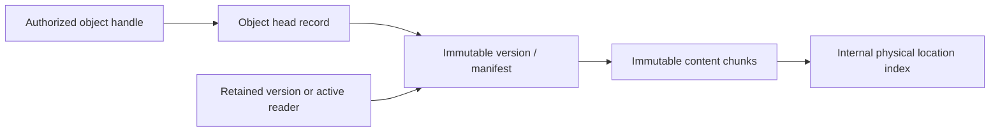

# DBFS storage foundation

| Status | Scope |
| --- | --- |
| Proposed | Engine-selection and layout experiment; no accepted disk format or production API |
| Specification owner | [Realms and objects](../spec/storage/realms_and_objects.md) accepts independent-copy behavior; engine, layout and identity remain proposed |
| Existing evidence | [Object store](../../source-rs/platform/libraries/database-objects/README.md): numbered objects, shared content, copies, pins and bounded collection behind private roots |
| New evidence | [Host layout lab](../../tools/storage-lab/README.md): flat/tree chunk references, inline contents, range reads, batched edits and retained versions |

## Direction and boundaries

DBFS should build on established database techniques. A transactional ordered
key/value metadata engine plus immutable bulk-content storage is a candidate,
not a chosen implementation. BLAKE3 is the provisional content-hash candidate;
its internal 1 KiB hashing chunks do not choose storage chunk boundaries.
Neither this proposal nor the host lab freezes a hash encoding or on-disk ABI.

Storage policy, object semantics, queries, version retention and subscriptions
belong in the common userspace platform. The kernel supplies isolation, IPC,
memory and device authority. Distribution supplies defaults and user experience.
Atomic changes spanning durable storage and kernel authority remain the existing
[owner question](../../OWNER_QUESTIONS.md#kernel-mechanisms-versus-platform-orchestration).

The immediate requirement is a bounded foundation for small objects and large
byte streams, with efficient range edits and explicit committed versions. Its
public model must not expose global hash lookup as read authority. Sharing
physical content does not merge object identity or realm authority.

## Candidate representation

| Record | Meaning |
| --- | --- |
| Object ID to head version | Stable identity across edits; mutations authorized at this boundary |
| Version to metadata and content manifest | Immutable state, including logical length and representation |
| Content digest to physical location(s) | Internal, movable placement; no application authority |
| Parent ID and name to child reference | Namespace edges; sharing and alias semantics remain proposed |
| Commit sequence to changes | Durable observation records published with the affected state |

The logical object graph can live over ordinary indexed records. A graph-shaped
interface does not select a graph database. Logical object identity, version
identity, content digest and physical location must remain distinguishable.
Hash inputs need a canonical encoding, explicit lengths and separation between
node kinds. Empty content has its actual digest; an inert zero handle is a
separate API convention, never an assertion that BLAKE3(empty) is all zeroes.

The host experiment implements chunks, flat or fixed-fanout tree manifests, range
reads, batched range replacement and an explicit list of retained versions. It does not implement the object table, capabilities,
queries or publication transaction in this diagram.

## One update and its failure boundary

For a 100-byte replacement in a 10 MiB object:

1. Resolve authorized object identity and capture the expected revision.
2. Construct replacement chunks and a new version, reusing unchanged content.
3. Ensure new backing will be durable before its references can be recovered.
4. In the metadata transaction, validate conflicts and authority, then publish
   the object head, relevant indexes and the committed change record together.
5. Acknowledge only after the engine's durability obligation completes.

Readers may continue using an older pinned version. An interrupted unpublished
write may leave unreachable content; recovery and reclamation must account for
it. A published reference must never target missing backing. A lost acknowledgement
can leave a committed write, so retries need an operation identity or reconciliation.
The existing catalog lab exercises the lost-acknowledgement distinction already.

This is an invariant to require of an engine, not a claim that a pointer write or
one flush implements it. If blobs and metadata use different physical structures,
their ordering and recovery are part of one design. Old backing cannot be reused
until committed roots, history and active readers no longer require it.

Realm boundaries scope naming and authority; they do not automatically define
transaction participants. One engine may atomically update several authorized
realms. Two-phase commit is relevant when independently committing participants
must agree, with explicit recovery and availability costs. A local durable
change log and subscriber cursor do not require CRDTs. Independently writable
replicas require a separate conflict/convergence design; arbitrary byte streams
do not acquire useful merge semantics merely by being logged.

## Engine families to evaluate

These are study candidates, not performance conclusions or port commitments.

| Family | Why investigate it | Evidence needed for Cathedral |
| --- | --- | --- |
| Copy-on-write B+ tree / shadow paging | Ordered metadata and retained roots fit naturally | Path-copy write cost, snapshot pressure, free-space recovery and reader lifetime |
| B-tree with journal/WAL | Established local transaction and recovery machinery | Random-write cost, checkpoints, history support and blob integration |
| Log-structured merge tree | Batched ingestion and ordered indexes | Compaction amplification, read amplification, tail latency and bounded maintenance space |

Compare reusable implementations as well as algorithms. OS/filesystem, allocator,
threading, locking and mapping assumptions determine port cost. Selecting a
database design does not authorize a fresh handwritten engine by default.

Primary study sources: [LMDB API and architecture](https://github.com/LMDB/lmdb/blob/mdb.master/libraries/liblmdb/lmdb.h),
[SQLite atomic commit](https://www.sqlite.org/atomiccommit.html),
[SQLite WAL](https://www.sqlite.org/wal.html),
[RocksDB overview](https://github.com/facebook/rocksdb/wiki/RocksDB-Overview),
[FoundationDB's layered transactional model](https://apple.github.io/foundationdb/developer-guide.html),
and [the official BLAKE3 implementation](https://github.com/BLAKE3-team/BLAKE3).

## Evidence before an engine or format commitment

Start with the host layout lab: 4/16/64 KiB fixed chunks, with and without a
128-byte inline threshold. Measure tiny objects, a sequential 10 MiB object,
aligned and boundary-crossing 100-byte replacements, repeated edits with and
without history, identical-content copies and a one-byte prefix insertion.
Use deterministic byte fixtures and check reconstructed data after every case.

The [comparison](../../tools/storage-lab/README.md#observed-comparison) now runs
flat manifests against fanout-32 and fanout-128 copy-on-write reference trees.
It measures batched versus separate publication and the packed metadata needed
for cold range reads. With 4 KiB payload chunks, an aligned small edit changes
81,937 bytes of flat metadata versus 2,212 bytes in the fanout-32 tree. The latter
also needs four metadata records on a cold range read, versus one large flat
record. These results justify separating content chunks from updateable reference
structure, not selecting a production fanout, engine or allocation unit.
Packed content lengths exclude index keys, allocation rounding, logs, replication,
compression and allocator overhead. Host elapsed time is not storage throughput.
Content-defined chunking remains a candidate for shifted-input reuse; changing
the chunking algorithm does not decide the metadata engine.

The [engine comparison](../../tools/storage-lab/engines/README.md) now applies
identical byte records to redb 4.4.0 and SQLite in DELETE/WAL modes. Its 48 cells
verify ordered event scans and full record equality after reopen. Nine additional
checks cover process death before/after commit and failed capacity growth. Content,
head and change records share one engine transaction; this baseline keeps blobs
inside the engine too. It does not yet test external-blob publication or DBFS queries.

At 4 KiB chunk size, one tree-32 edit submits 6,555 key/value bytes and causes
61,760 redb backend write bytes; the flat layout submits 86,181 and causes 172,352.
Batching 64 adjacent edits reduces tree-32 backend writes from 3,960,832 to 65,856
bytes and syncs from 64 to one. File lengths and SQLite sidecars are recorded
separately: neither means physical media writes or allocated disk blocks.
An isolated redb `no_std` backend probe compiles for both x86-64 and ARM64
bare-metal targets. It remains an experimental candidate, not a selected production engine. The
guest proofs below now integrate a funded allocator and bounded device adapter;
production resource guarantees and concurrency remain further work.

The [publication stress lab](../../tools/storage-lab/engines/stress/README.md) now
prepares owned payloads/hashes before writer acquisition, validates expected
revisions inside the transaction, and rejects an entire batch on any conflict.
It measures queueing and writer occupancy beside a bulk importer and concurrent
readers. A large atomic import delays interactive writes more in the recorded
sample; splitting it changes atomicity and is not a transparent optimization.

Its volatile/durable backend passes 150 crash cuts across writes, length changes
and syncs for two payload sizes and retained/retired old records. It requires exact
old-or-new recovery and valid content/event references. Releasing a pinned reader
allows 289 replacements under the same capacity cap, then recovery from capacity
refusal without lifting that cap. These bounded patterns do not exhaust arbitrary
device faults, recovery failures or general reclamation states.

The [admission lab](../../tools/storage-lab/engines/stress/admission/README.md) now
reserves logical payload bytes plus per-object charges before preparation, retaining
them through queueing and commit. It caps total/per-producer bytes and requests,
rejects oversized atomic transactions without splitting, and alternates ready
producers. Three trials complete 384 publications with accounting returned to zero;
failure tests cover cancellation, conflicts, preparation failure and engine errors.
The policy bounds request contents, not total RAM, engine work or commit duration.
Producer identity is assigned in the lab; a guest policy would need capability-backed
budget ownership and bounded identities. No production priority contract is selected.

Next compare controlled arrival rates and producer windows, extend failure histories,
and add metadata queries. Measure physical bytes read/written,
flushes, peak RAM, read latency, reclamation work and reserved free space under
near-full operation and pinned history. An in-memory reachability sweep is not
evidence that production collection or full-disk progress works.

Promotion requires reproducible workload results, explicit crash assumptions,
old-or-new recovery tests, conflict/isolation tests and a bounded reclamation
strategy. Kernel integration follows a viable userspace engine; QEMU cannot
substitute for those semantics or establish physical-device performance.

The [experimental volume bootstrap](../../tools/storage-lab/engines/volume/README.md)
now gives the engine a bounded region of a raw image. Its envelope separates volume
identity/version/geometry and logical engine length from redb's internal format.
Formatting first marks the volume incomplete and publishes ready only after durable
engine initialization. Opening never falls back to formatting. Redundant checksummed
copies and deterministic fault checks exercise that transition; this is not an
accepted disk ABI or an installer/partition-table implementation. The adapter
currently adds durable envelope updates around length changes, so its performance
and on-device flush contract need evaluation before guest promotion.

The [guest block-boundary proof](../../source-rs/platform/libraries/storage-volume/CHARTER.md)
now shares that envelope codec and checks byte/sector translation, explicit ATA
flush, cold reboot and damaged-copy refusal. Its host-formatted database remains
opaque to the guest; the host compares the whole image and reopens the engine.
The separate funded-heap proof now runs actual guest engine transactions and
unclean recovery within bounded memory/image admission. This does not change the
kernel/platform ownership or select a permanent database engine.

The [private content guest proof](../../source-rs/distribution/lab/objects/README.md)
now shares the host manifest encoder and BLAKE3 domains, and publishes real chunks,
manifest, head, event and quota ledger in one guest transaction. Two clients have
explicitly granted private roots and no disk authority. Immutable attachments keep
hashing and persistence on the same bytes; preparation precedes writer acquisition
and expected revisions are revalidated inside it. Refused writes abort all staged
records. A cold guest reconstructs acknowledged contents, and an independent host
model verifies exact retained records on image copies. Allocation samples cover
recovery, preparation, commit and close.

This remains one object per root with 16 KiB contents and a 24 KiB retained-record
quota. Two durable root-owned pin slots and bounded collection now protect the
current head and selected revisions. Each immediate transaction removes at most
eight retired records and updates exact logical accounting; events are removed
before their content so interleaved pin requests cannot resurrect broken closures.
Host checks reopen after each pass and run 600 replacements under a fixed extent;
three guest boots exercise pins, release, reclamation and sealed bulk reads.

The guest store now holds many numbered objects per root, sharing chunks and
manifests within the root, with a copy operation that writes only a new head and
event. The matrix desktop's Notes app saves, duplicates and switches notes through
that store over ordinary matrix IPC, and an independent host oracle checks the
retained records after a cold boot: two notes, one shared manifest. This is the
first point at which cheap copies exist in the booted OS. Copies are independent
identities, as the identity question below recommends; nothing here accepts that
recommendation, resolves cross-root sharing or settles production semantics.

Logical quota is not reserved physical engine space. General reclamation,
full-volume progress, watcher replay, larger trees, crash cuts inside the guest
protocol and multi-object predicates still need work. Bulk output remains funded
by the provider until the final reader releases it; transferable sponsorship and
per-client fairness need further design. An intermittent ATA busy timeout remains
undiagnosed, with operation/phase diagnostics and optional QEMU tracing now in place.
These are engineering gaps, not new owner semantics; the existing questions below
remain open.

## Performance boundaries to preserve

- Prepare independent work before writer acquisition; revalidate the versions
  that preparation depended on at publication. General predicate conflicts remain
  part of the unresolved isolation contract.
- Bound admitted bytes and outstanding requests, record queue delay separately
  from writer occupancy, and expose transaction/batch boundaries explicitly.
  A request-count limit alone cannot bound memory for arbitrary payload sizes.
- Keep owned buffer lifetimes clear enough to support future copy avoidance.
  Bytes must not change between hashing and persistence; unprotected shared memory
  does not satisfy this invariant.
- Keep logical chunks independent of physical packing, placement and IO requests.
  Do not freeze one IPC, allocation or device operation per content chunk.
- Fund reader pins, retained versions and maintenance headroom. Treat the scope of
  global ordering, deduplication and atomicity as explicit semantic choices rather
  than accidental consequences of the first single-writer engine.

The current all-in-engine stress protocol still inserts bulk bytes while holding
the writer. External blob storage could change that cost but introduces separate
durability and orphan-recovery obligations. SIMD and worker pools can accelerate
preparation without changing canonical digests or publication semantics; they
cannot remove serialization already imposed by those semantics.

## Owner choices and compatibility

[Owner questions](../../OWNER_QUESTIONS.md) track object aliases and realm
authority, deduplication/encryption boundaries, retention/subscriber promises,
and cross-record isolation. Existing kernel/storage authority questions still
apply. Chunk sizes, fanout, benchmark fixtures and engine comparisons are ordinary
engineering experiments, not requests for owner approval.

Changes to identity or alias semantics affect persisted references. Changes to
history guarantees affect backups and watcher replay. Cross-domain deduplication
affects accounting, confidentiality and erasure. The lab uses one trusted local
domain and does not resolve any of these choices. No current guest catalog is
migrated or claimed compatible with the experimental manifest encoding.
